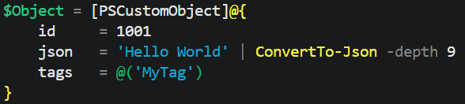
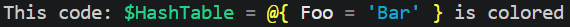

# ColorCode

This class colors the code provided in a expression string or script block.

## Syntax

```PowerShell
[ColorCode]'<Expression>'
```

```PowerShell
[ColorCode]{<Expression>}
```

## Examples

### Example 1

Color an assignment expression

```PowerShell
$Code = {$Object = [PSCustomObject]@{
    id     = 1001
    json   = 'Hello World' | ConvertTo-Json -depth 9
    tags   = @('MyTag')
}}
[ColorCode]$Code
```



## Examples

### Example 2

Embedded colored code in a string:

```PowerShell
"This code: $([ColorCode]{$HashTable = @{ Foo = 'Bar' }}) is colored"
```

